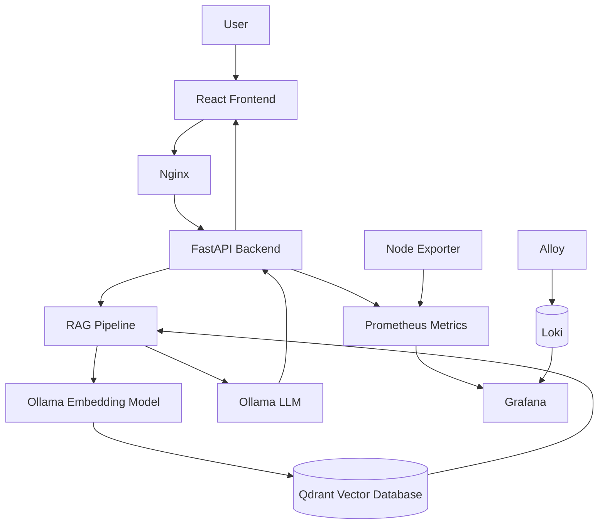
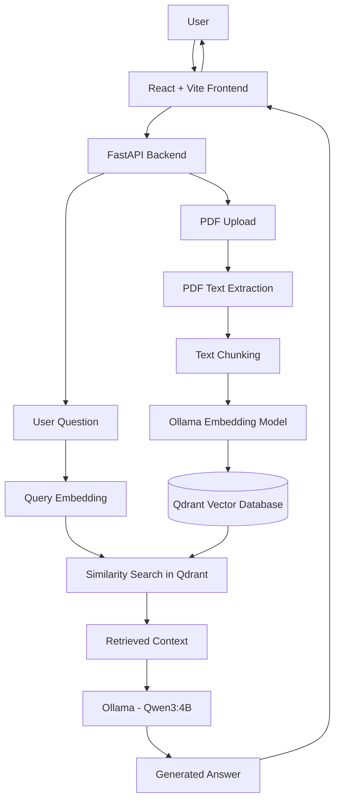
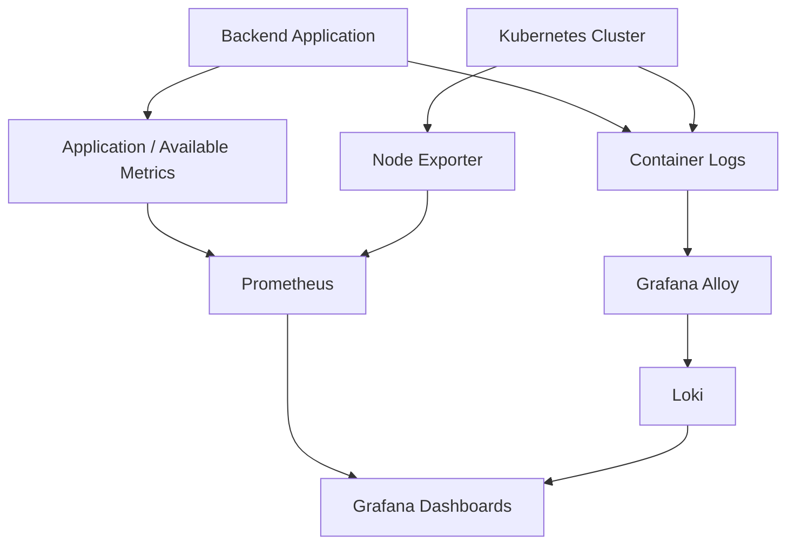
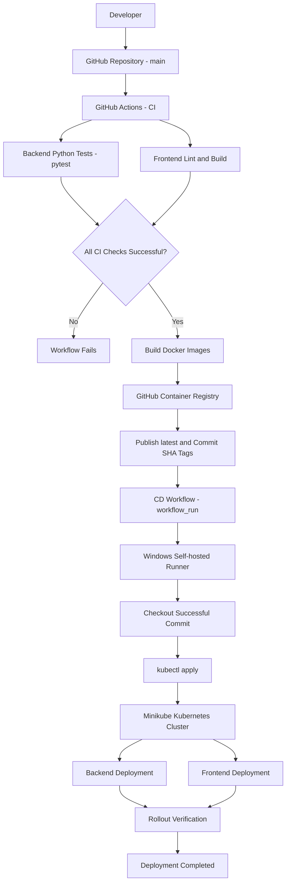

# Enterprise AI Knowledge Assistant

An AI-powered knowledge assistant that allows users to upload PDF documents and ask questions about their content. It uses Retrieval-Augmented Generation (RAG) to retrieve relevant information from documents and generate context-aware answers with source citations.

The project is built using React, FastAPI, Ollama, and Qdrant, with containerization through Docker and orchestration through Kubernetes. It also includes an observability stack using Prometheus, Grafana, Loki, Alloy, and Node Exporter.

## Key Features

- **PDF Upload:** Upload PDF documents through the web interface.
- **AI-Powered Question Answering:** Ask questions about uploaded documents using a RAG pipeline.
- **Context-Aware Responses:** Retrieve relevant document chunks before generating answers.
- **Source Citations:** Display references to the source documents used to generate answers.
- **Document Management:** Delete uploaded documents.
- **Local LLM Integration:** Use Ollama to run local language and embedding models.
- **Vector Search:** Store and retrieve document embeddings using Qdrant.
- **REST API:** Backend APIs built using FastAPI.
- **Containerization:** Package the frontend and backend using Docker.
- **Kubernetes Deployment:** Deploy and manage application components using Minikube.
- **Monitoring:** Collect application and infrastructure metrics using Prometheus and Node Exporter.
- **Centralized Logging:** Collect Kubernetes pod logs using Alloy and store them in Loki.
- **Dashboards:** Visualize metrics and logs through Grafana.

## Architecture



### Application Flow

1. The user uploads a PDF through the React frontend.
2. The frontend communicates with the FastAPI backend through Nginx.
3. The backend processes the document and generates embeddings using Ollama.
4. Document embeddings are stored in Qdrant.
5. When a user asks a question, the RAG pipeline retrieves relevant document chunks.
6. Ollama generates an answer using the retrieved context.
7. The frontend displays the answer along with source citations.

### Observability Flow

- Prometheus collects metrics from the backend and Node Exporter.
- Alloy discovers and collects Kubernetes pod logs.
- Alloy forwards logs to Loki.
- Grafana visualizes metrics and logs through dashboards.

## Technology Stack

| Layer            | Technologies                   |
| ---------------- | ------------------------------ |
| Frontend         | React 19, Vite, JavaScript     |
| Web Server       | Nginx                          |
| Backend          | Python, FastAPI                |
| AI / LLM         | Ollama, Qwen3 4B               |
| Embeddings       | Qwen3 Embedding 0.6B           |
| RAG              | Retrieval-Augmented Generation |
| Vector Database  | Qdrant                         |
| Containerization | Docker                         |
| Orchestration    | Kubernetes, Minikube           |
| Metrics          | Prometheus, Node Exporter      |
| Logging          | Grafana Alloy, Loki            |
| Visualization    | Grafana                        |
| Version Control  | Git, GitHub                    |

## Project Structure

```text
Enterprise-AI-Knowledge-Assistant/
│
├── backend/
│   ├── app/
│   │   └── routes/
│   │       └── health.py
│   └── Dockerfile
│
├── frontend/
│   ├── src/
│   │   └── services/
│   │       └── api.js
│   ├── nginx.conf
│   └── Dockerfile
│
├── deployment/
│   ├── docker-compose.yaml
│   └── kubernetes/
│       ├── namespace.yaml
│       ├── backend.yaml
│       ├── frontend.yaml
│       ├── ingress.yaml
│       ├── prometheus.yaml
│       ├── node-exporter.yaml
│       ├── loki.yaml
│       ├── alloy.yaml
│       └── grafana.yaml
│
├── monitoring/
│   ├── prometheus.yml
│   ├── prometheus-k8s.yml
│   ├── loki-config.yml
│   ├── alloy-config.alloy
│   └── alloy-k8s.alloy
│
├── .gitignore
└── README.md
```

_Note: The structure above highlights the main project and deployment files._

## Prerequisites

Install the following tools before running the project:

- Docker Desktop
- Git
- Ollama
- Kubernetes CLI (`kubectl`)
- Minikube
- A system with sufficient memory and CPU resources to run the local AI models and Kubernetes workloads.

For local AI inference, download the required Ollama models:

```bash
ollama pull qwen3:4b
ollama pull qwen3-embedding:0.6b
```

Ensure Ollama is running and accessible from the application environment.

## Running the Application

### 1. Docker Compose

From the project root directory:

```bash
docker compose -f deployment/docker-compose.yaml up -d --build
```

Check running containers:

```bash
docker ps
```

To inspect logs:

```bash
docker compose -f deployment/docker-compose.yaml logs -f
```

Use the service ports configured in the Compose file to access the application and monitoring interfaces.

### 2. Kubernetes Deployment Using Minikube

Start Minikube:

```bash
minikube start --driver=docker
```

Enable the Ingress addon:

```bash
minikube addons enable ingress
```

Apply the Kubernetes namespace:

```bash
kubectl apply -f deployment/kubernetes/namespace.yaml
```

Apply the application and monitoring resources:

```bash
kubectl apply -f deployment/kubernetes/
```

Check the deployed resources:

```bash
kubectl get pods -n enterprise-ai
kubectl get services -n enterprise-ai
kubectl get deployments -n enterprise-ai
```

Wait until the required pods reach the `Running` and `Ready` states.

### 3. Access the Application

The application is configured with the Ingress hostname:

```text
enterprise-ai.local
```

For local Windows access, configure the hosts file with:

```text
127.0.0.1 enterprise-ai.local
```

Start the Ingress port-forward:

```bash
kubectl port-forward service/ingress-nginx-controller 8081:80 -n ingress-nginx
```

Open:

```text
http://enterprise-ai.local:8081
```

Keep the port-forward terminal running while accessing the application.

### 4. Access Monitoring Tools

Start port-forwarding in separate terminals.

**Grafana**

```bash
kubectl port-forward service/grafana 3003:3000 -n enterprise-ai
```

Open: `http://localhost:3003`

**Prometheus**

```bash
kubectl port-forward service/prometheus 9091:9090 -n enterprise-ai
```

Open: `http://localhost:9091`

Grafana is configured to visualize application metrics and centralized logs using Prometheus and Loki data sources.

## Monitoring and Observability

The project includes an integrated observability stack.

| Component     | Responsibility                             |
| ------------- | ------------------------------------------ |
| Prometheus    | Collects and stores time-series metrics    |
| Node Exporter | Exposes infrastructure and system metrics  |
| Grafana Alloy | Discovers and collects Kubernetes pod logs |
| Loki          | Stores and queries centralized logs        |
| Grafana       | Provides dashboards for metrics and logs   |

The Grafana dashboard includes panels for:

- Backend memory usage
- Backend CPU usage
- Network transmit traffic
- Network receive traffic
- Backend availability
- Kubernetes pod logs

### Useful Verification Commands

Check all pods:

```bash
kubectl get pods -n enterprise-ai
```

Check services:

```bash
kubectl get svc -n enterprise-ai
```

Check backend logs:

```bash
kubectl logs deployment/backend -n enterprise-ai
```

Check backend health:

```bash
kubectl port-forward service/backend 8000:8000 -n enterprise-ai
```

Then open:

```text
http://localhost:8000/health
```

Check backend metrics:

```text
http://localhost:8000/metrics
```

## Important Configuration Notes

- Ollama must be running and the required models must be available.
- The Kubernetes backend configuration uses `host.minikube.internal` to communicate with host-running Ollama and Qdrant services.
- Qdrant must be available on port `6333`.
- Application images must be available to the Minikube cluster before starting deployments when using `imagePullPolicy: Never`.
- Persistent volumes are used for application uploads and monitoring data.
- Do not delete persistent volumes when stopping or restarting Minikube.
- Configure credentials and environment variables securely. Do not commit private keys, API keys, passwords, or uploaded documents to GitHub.

## Troubleshooting

**Pods are not starting**

```bash
kubectl get pods -n enterprise-ai
kubectl describe pod <pod-name> -n enterprise-ai
```

**Check application logs**

```bash
kubectl logs deployment/backend -n enterprise-ai
```

**Check Minikube status**

```bash
minikube status
```

**Check Kubernetes resources**

```bash
kubectl get all -n enterprise-ai
```

**Restart Minikube**

```bash
minikube stop
minikube start --driver=docker
```

After restarting Minikube, restart the required port-forward commands.

## Future Improvements

- Authentication and role-based access control.
- Improved document processing and retrieval strategies.
- More comprehensive automated testing.
- Alerting and advanced observability.
- Production-ready deployment and secrets management.
- Performance optimization and resource tuning.

## Author

Developed as an Enterprise AI Knowledge Assistant project, combining document-based question answering, local AI inference, vector search, Kubernetes deployment, and integrated observability.

---

# Latest Implementation Updates — CI/CD, Kubernetes Deployment & Observability

This section documents the latest implementation updates to the Enterprise AI Knowledge Assistant, including automated CI/CD, GitHub Container Registry (GHCR), Kubernetes deployment through a Windows self-hosted runner, and the integrated observability stack.

The original project documentation and architecture are retained above. This section extends the documentation with the latest verified implementation.

## 1. Updated End-to-End System Architecture

### 1.1 Application Architecture — RAG Workflow

The application follows a Retrieval-Augmented Generation (RAG) architecture. Users interact with the React frontend, while the FastAPI backend handles document processing, retrieval, and answer generation.



**Application workflow:**

1. The user uploads a PDF through the React frontend.
2. The FastAPI backend extracts text from the document.
3. Extracted text is divided into smaller chunks.
4. The embedding model converts the chunks into vector representations.
5. The vectors and associated document information are stored in Qdrant.
6. When a user asks a question, the backend generates a query embedding.
7. Qdrant retrieves relevant document chunks through similarity search.
8. Retrieved context is passed to the Qwen3:4B language model through Ollama.
9. The generated answer is returned to the frontend.

### 1.2 Observability Architecture

The project includes a monitoring and logging stack to observe application and infrastructure health.



**Components:**

- **Prometheus:** Collects and stores time-series metrics.
- **Node Exporter:** Exposes host-level system metrics.
- **Grafana Alloy:** Collects and forwards configured logs.
- **Loki:** Stores and queries log data.
- **Grafana:** Provides dashboards for visualizing metrics and logs.

### 1.3 Automated CI/CD Architecture

The project now includes automated Continuous Integration and Continuous Deployment using GitHub Actions, GHCR, a Windows self-hosted runner, and Minikube.



**CI workflow:**

1. A code push to the `main` branch triggers GitHub Actions.
2. Backend dependencies are installed and Python tests run using pytest.
3. Frontend dependencies are installed using `npm ci`.
4. Frontend linting and production build are executed.
5. Docker images for the backend and frontend are built.
6. Images are published to GitHub Container Registry.
7. Images are tagged with `latest` and the corresponding commit SHA.

**CD workflow:**

1. The deployment workflow listens for completion of the CI workflow.
2. Deployment proceeds only when CI succeeds and the triggering event is a push to `main`.
3. The Windows self-hosted runner checks out the successful commit.
4. Kubernetes manifests are updated with the corresponding commit-specific image tags.
5. `kubectl apply` applies the backend and frontend manifests to Minikube.
6. Kubernetes rollout status is checked for both deployments.

**Important:** The self-hosted runner connects the GitHub-hosted workflow system to the local Minikube environment. The laptop, Docker Desktop, Minikube, and runner must be available for automatic deployment.

---

## 2. CI/CD Implementation Details

### GitHub Actions

Workflow files:

```text
.github/
└── workflows/
    ├── ci.yml
    └── deploy.yml
```

| Workflow     | Responsibility                                                        |
| ------------ | --------------------------------------------------------------------- |
| `ci.yml`     | Backend tests, frontend validation, Docker image build and publishing |
| `deploy.yml` | Automated deployment to local Minikube after successful CI            |

### GitHub Container Registry (GHCR)

The following container images are published:

```text
ghcr.io/mahisharma-2023a1r078/enterprise-ai-knowledge-assistant/backend

ghcr.io/mahisharma-2023a1r078/enterprise-ai-knowledge-assistant/frontend
```

Image tags include:

- `latest` — latest published image.
- Commit SHA — identifies the exact source revision used to build the image.

The Kubernetes manifests use GHCR image references and:

```yaml
imagePullPolicy: Always
```

The CD workflow replaces the `latest` image tag with the successful commit SHA before applying the manifests.

### Kubernetes deployment manifests

```text
deployment/
└── kubernetes/
    ├── backend.yaml
    ├── frontend.yaml
    └── alloy.yaml
```

The backend manifest includes its Deployment, Service, and upload PersistentVolumeClaim configuration. The frontend manifest includes its Deployment and Service.

---

## 3. Latest Deployment Verification

The automated deployment was successfully verified using the following commit:

```text
1dda5336379d555d1657b2b415ac131d752b24ce
```

Both deployed images were confirmed to use this exact commit SHA:

```text
Backend:
ghcr.io/mahisharma-2023a1r078/enterprise-ai-knowledge-assistant/backend:1dda5336379d555d1657b2b415ac131d752b24ce

Frontend:
ghcr.io/mahisharma-2023a1r078/enterprise-ai-knowledge-assistant/frontend:1dda5336379d555d1657b2b415ac131d752b24ce
```

### Kubernetes health verification

The following command was used:

```powershell
kubectl get pods,deployments -n enterprise-ai
```

Verified workload status:

| Component     | Verified status |
| ------------- | --------------- |
| Backend       | 1/1 Running     |
| Frontend      | 1/1 Running     |
| Prometheus    | 1/1 Running     |
| Node Exporter | 1/1 Running     |
| Loki          | 1/1 Running     |
| Grafana Alloy | 1/1 Running     |
| Grafana       | 1/1 Running     |

All six deployments were reported as `1/1 READY`.

### GitHub Actions verification

- CI workflow run #9 — Successful.
- Deployment workflow run #2 — Successful.
- Backend and frontend Kubernetes rollouts — Successful.
- Commit-specific GHCR images — Verified in Kubernetes deployment specifications.

These results verify the automated CI/CD workflow and the successful application deployment to the local Minikube cluster.

---

## 4. Completed Project Deliverables

The following implementation work has been completed or verified:

- [x] React + Vite frontend.
- [x] FastAPI backend.
- [x] PDF-based document ingestion and RAG workflow.
- [x] Ollama integration with Qwen3:4B.
- [x] Ollama embedding model integration.
- [x] Qdrant vector database integration.
- [x] Docker containerization for backend and frontend.
- [x] Kubernetes deployment manifests.
- [x] Local Minikube deployment.
- [x] Backend and frontend Kubernetes Services.
- [x] Backend upload PersistentVolumeClaim configuration.
- [x] Prometheus monitoring.
- [x] Node Exporter integration.
- [x] Loki log aggregation.
- [x] Grafana Alloy log collection.
- [x] Grafana dashboards.
- [x] GitHub Actions CI workflow.
- [x] Automated Python tests using pytest.
- [x] Frontend linting and production build checks.
- [x] Docker image publishing to GHCR.
- [x] Commit-SHA-based image tagging.
- [x] Windows self-hosted GitHub Actions runner.
- [x] Automated Minikube deployment through GitHub Actions.
- [x] Kubernetes rollout verification.

---

## 5. Project Validation, Verification and Future Improvements

This section summarizes the implementation and validation performed for the Enterprise AI Knowledge Assistant. The core application, Kubernetes deployment, CI/CD pipeline, and observability stack have been implemented and tested.

### A. Application and RAG Validation

The following application features have been implemented and verified:

- Fresh PDF upload and document ingestion.
- Question-answering based on uploaded PDF content.
- Multiple questions against uploaded documents.
- Multi-PDF RAG functionality using a shared knowledge base.
- Retrieval of information across multiple uploaded PDFs.
- Frontend-backend communication.
- Integration with Ollama for language model inference.
- Integration with the embedding model for document vectorization.
- Qdrant integration for vector storage and retrieval.

**Validation result:** PDF upload, single-PDF question-answering, and multi-PDF RAG functionality were tested successfully through the application.

### B. Observability Validation

The monitoring and centralized logging stack has been implemented and verified.

**Prometheus and Node Exporter**

- Prometheus service successfully running inside Kubernetes.
- Node Exporter successfully deployed.
- All three configured Prometheus targets reported `UP`.
- Prometheus API queries returned successful metric results.
- The `up` metric returned a value of `1` for Prometheus, backend, and Node Exporter.

**Grafana Alloy and Loki**

- Grafana Alloy successfully collecting Kubernetes pod logs.
- Loki successfully receiving and storing log entries.
- Actual backend and Kubernetes log entries retrieved through Loki API queries.
- Loki labels and log streams successfully verified.

**Grafana**

- Grafana dashboard successfully accessible.
- Prometheus datasource connection verified.
- Loki datasource connection verified.
- Dashboard metric visualizations successfully displaying data.
- Actual Kubernetes logs successfully queried through Grafana Explore.

**Validation result:** The Prometheus metrics collection and Alloy-to-Loki logging pipelines have been tested successfully, and their data is visible through Grafana.

**Additional observations:**

During testing, Loki reported `negative structured metadata bytes received` errors. Kubernetes also displayed a deprecated Endpoints API warning, recommending the newer EndpointSlice API.

These observations did not prevent successful metrics collection, log ingestion, or dashboard visualization. They remain candidates for configuration cleanup and further investigation.

### C. CI/CD Implementation and Validation

The automated CI/CD pipeline has been implemented using GitHub Actions and a Windows self-hosted runner.

**Continuous Integration (CI)**

- GitHub Actions workflow configured for pushes to the `main` branch and pull requests targeting `main`.
- Automated backend dependency installation and pytest execution.
- Automated frontend dependency installation, linting, and production build.
- CI workflow successfully executed.

**Container Image Publishing**

- Backend and frontend Docker images built through GitHub Actions.
- Images published to GitHub Container Registry (GHCR).
- `latest` and commit-specific image tags generated.
- Public GHCR packages verified.

Published image repositories:

```text
ghcr.io/mahisharma-2023a1r078/enterprise-ai-knowledge-assistant/backend

ghcr.io/mahisharma-2023a1r078/enterprise-ai-knowledge-assistant/frontend
```

**Continuous Deployment (CD)**

- Windows self-hosted GitHub Actions runner configured.
- Deployment workflow triggered after successful CI completion on the `main` branch.
- Backend and frontend Kubernetes manifests applied automatically.
- Commit-specific GHCR image tags used for deployment.
- Kubernetes rollout status verified.
- Updated backend and frontend pods successfully deployed on Minikube.

**Validation result:** Both CI and CD workflows completed successfully. The application was deployed automatically to the local Minikube cluster using the self-hosted runner.

### D. Final Implementation Summary

The following major project components have been implemented:

| Component           | Implementation         |
| ------------------- | ---------------------- |
| Frontend            | React + Vite           |
| Backend             | FastAPI                |
| LLM                 | Ollama                 |
| Embeddings          | Ollama embedding model |
| Vector Database     | Qdrant                 |
| Document Processing | PDF ingestion and RAG  |
| Containerization    | Docker                 |
| Orchestration       | Kubernetes             |
| Local Cluster       | Minikube               |
| CI/CD               | GitHub Actions         |
| Container Registry  | GHCR                   |
| Metrics Monitoring  | Prometheus             |
| System Metrics      | Node Exporter          |
| Log Collection      | Grafana Alloy          |
| Log Storage         | Loki                   |
| Visualization       | Grafana                |

### E. Additional Hardening and Future Improvements

The current implementation is a functional local Kubernetes deployment intended to demonstrate an end-to-end AI-powered knowledge assistant and its supporting DevOps infrastructure.

The following improvements can strengthen the implementation further:

- Verify uploaded-document persistence after a backend pod restart.
- Investigate Loki structured metadata errors and improve log ingestion configuration.
- Replace deprecated Kubernetes Endpoints API usage with EndpointSlice-compatible discovery where applicable.
- Perform a detailed security audit of the public repository and Windows self-hosted runner.
- Review GitHub Actions permissions, workflow triggers, and protection against untrusted pull requests.
- Strengthen secret management and access controls.
- Add more comprehensive integration and end-to-end tests.
- Add automated deployment rollback and notifications.
- Configure resource requests, limits, and autoscaling.
- Improve persistent storage backup and recovery.
- Deploy to a managed Kubernetes cluster for production use.
- Configure production-grade ingress, TLS, high availability, and access controls.

**Deployment limitation:** The current implementation uses local Minikube with a Windows self-hosted runner. It demonstrates automated deployment and Kubernetes orchestration but is not a production-grade, highly available cloud deployment.

---

## 6. Local Environment — Stop and Start Instructions

The application is deployed on a local Minikube cluster. The cluster and its workloads can be stopped and started without rebuilding the application, provided their persistent data and configuration are retained.

### 6.1 Safely Stop the Environment

Before shutting down, stop the foreground processes in their respective terminals.

**Step 1 — Stop Kubernetes Port-Forward Processes**

If a terminal is running a Kubernetes port-forward command, press:

```text
Ctrl + C
```

This stops the port-forward process only. It does not delete the application or Kubernetes resources.

Relevant port-forwards include:

Application ingress:

```powershell
kubectl port-forward -n ingress-nginx service/ingress-nginx-controller 8081:80
```

Prometheus:

```powershell
kubectl port-forward -n enterprise-ai service/prometheus 9090:9090
```

Loki:

```powershell
kubectl port-forward -n enterprise-ai service/loki 3101:3100
```

Grafana:

```powershell
kubectl port-forward -n enterprise-ai service/grafana 3001:3000
```

Stop only the port-forward processes that are currently running.

**Step 2 — Stop the GitHub Self-Hosted Runner**

Go to the separate PowerShell terminal running the runner:

```powershell
cd C:\actions-runner
```

Press:

```text
Ctrl + C
```

This stops the runner from listening for new GitHub Actions jobs. It does not uninstall or unregister the runner.

**Step 3 — Stop Minikube**

In a normal PowerShell terminal:

```powershell
minikube stop
```

This stops the local Kubernetes cluster while preserving its cluster resources.

**Step 4 — Close Docker Desktop**

After Minikube has stopped successfully, Docker Desktop can be exited from the Windows system tray if Docker is no longer needed.

Do not force-close Docker Desktop while Minikube is still running.

### 6.2 Start the Environment Again

**Step 1 — Start Docker Desktop**

Open Docker Desktop and wait until its engine is running.

**Step 2 — Start Minikube**

Open PowerShell:

```powershell
minikube start
```

Check the cluster:

```powershell
kubectl config current-context
kubectl get nodes
```

The context should be `minikube`, and the node should show `Ready`.

**Step 3 — Verify Kubernetes Workloads**

```powershell
kubectl get pods,deployments,services -n enterprise-ai
```

Wait until the required pods are running and deployments are ready.

Also verify ingress:

```powershell
kubectl get ingress -n enterprise-ai
```

**Step 4 — Start the Self-Hosted Runner**

Open a separate PowerShell window:

```powershell
cd C:\actions-runner
.\run.cmd
```

Wait for:

```text
Connected to GitHub
Listening for Jobs
```

Keep this terminal open whenever automatic CD is required.

**Step 5 — Start Application Access Through Ingress**

Open another PowerShell terminal and run:

```powershell
kubectl port-forward -n ingress-nginx service/ingress-nginx-controller 8081:80
```

Keep this terminal open.

Open the application in the browser:

```text
http://enterprise-ai.local:8081
```

If the application URL does not resolve, verify that the Windows hosts entry for `enterprise-ai.local` is still configured correctly.

**Step 6 — Start Monitoring Interfaces When Required**

Monitoring services can be accessed through separate port-forward terminals.

Prometheus:

```powershell
kubectl port-forward -n enterprise-ai service/prometheus 9090:9090
```

Open:

```text
http://localhost:9090
```

Loki:

```powershell
kubectl port-forward -n enterprise-ai service/loki 3101:3100
```

Open:

```text
http://localhost:3101/ready
```

Grafana:

```powershell
kubectl port-forward -n enterprise-ai service/grafana 3001:3000
```

Open:

```text
http://localhost:3001
```

Keep the respective terminals open while accessing these services.

If a local port is already occupied, select another available local port and update the browser URL accordingly. The Kubernetes service-side ports remain unchanged.

### 6.3 Useful Verification Commands

```powershell
# Check Minikube status
minikube status

# Check Kubernetes context
kubectl config current-context

# Check Kubernetes node
kubectl get nodes

# Check all application workloads
kubectl get pods,deployments,services -n enterprise-ai

# Check ingress
kubectl get ingress -n enterprise-ai

# Check backend logs
kubectl logs deployment/backend -n enterprise-ai --tail=50

# Check frontend logs
kubectl logs deployment/frontend -n enterprise-ai --tail=50

# Check deployed images
kubectl get deployments backend frontend -n enterprise-ai -o custom-columns="NAME:.metadata.name,IMAGE:.spec.template.spec.containers[0].image"

# Check Docker containers
docker ps
```

**Important Operational Notes:**

- `Ctrl + C` stops only the foreground process in that terminal.
- Do not use `kubectl delete` to shut down the environment.
- Do not run `minikube delete` unless intentionally removing the cluster.
- Do not remove Docker volumes or Kubernetes PersistentVolumeClaims if uploaded documents or other persistent data must be retained.
- Keep Docker Desktop running while Minikube is running with the Docker driver.
- Keep the Windows self-hosted runner terminal open for automatic GitHub Actions deployment.
- If Ollama is running separately on Windows, ensure its service and required models are available before testing RAG functionality.
- Kubernetes workloads normally restart when Minikube starts again, but verify their readiness before using the application.
- Monitoring port-forwards are optional and should be started only when accessing their respective interfaces.

---

## 7. Final Project Status

The Enterprise AI Knowledge Assistant has progressed from a locally developed Retrieval-Augmented Generation (RAG) application to a containerized Kubernetes deployment with integrated monitoring, centralized logging, and automated CI/CD.

The application provides PDF-based knowledge retrieval and question-answering using the integrated language model and vector database components. Multiple-PDF RAG functionality has also been tested successfully through the application.

### Implemented Capabilities

- React and Vite frontend.
- FastAPI backend.
- Ollama-based language model integration.
- Ollama embedding model integration.
- Qdrant vector database for document embeddings and retrieval.
- PDF ingestion and multi-document RAG question-answering.
- Docker containerization for backend and frontend.
- Kubernetes deployments and services on Minikube.
- GitHub Actions CI workflow.
- Automated backend and frontend testing and build.
- Docker image publishing to GitHub Container Registry (GHCR).
- Automated CD to local Minikube using a Windows self-hosted runner.
- Prometheus and Node Exporter for metrics collection.
- Grafana Alloy for Kubernetes pod log collection.
- Loki for centralized log storage and querying.
- Grafana dashboards for metrics and log visualization.

### Verified Milestones

- Fresh PDF upload and question-answering tested successfully.
- Multiple-PDF knowledge retrieval tested successfully.
- Kubernetes application workloads verified as running.
- Prometheus targets verified as UP, with successful metric queries.
- Alloy-to-Loki log ingestion verified using actual log entries.
- Grafana Prometheus and Loki data sources tested successfully.
- Grafana dashboards and Explore log queries verified.
- GitHub Actions CI and CD workflows completed successfully.
- Backend and frontend images deployed to Minikube using commit-specific GHCR tags.

The latest verified automated deployment milestone used commit:

```text
1dda5336379d555d1657b2b415ac131d752b24ce
```

### Conclusion

The project demonstrates an end-to-end implementation of an AI-powered Enterprise Knowledge Assistant with document ingestion, multi-PDF RAG, vector search, containerization, Kubernetes orchestration, automated CI/CD, metrics monitoring, and centralized logging.

The implementation successfully demonstrates the integration of AI application development and DevOps practices within a local Kubernetes environment.

Further improvements can focus on production hardening, security, persistent-data recovery, log pipeline cleanup, high availability, and deployment to a managed cloud Kubernetes platform.
