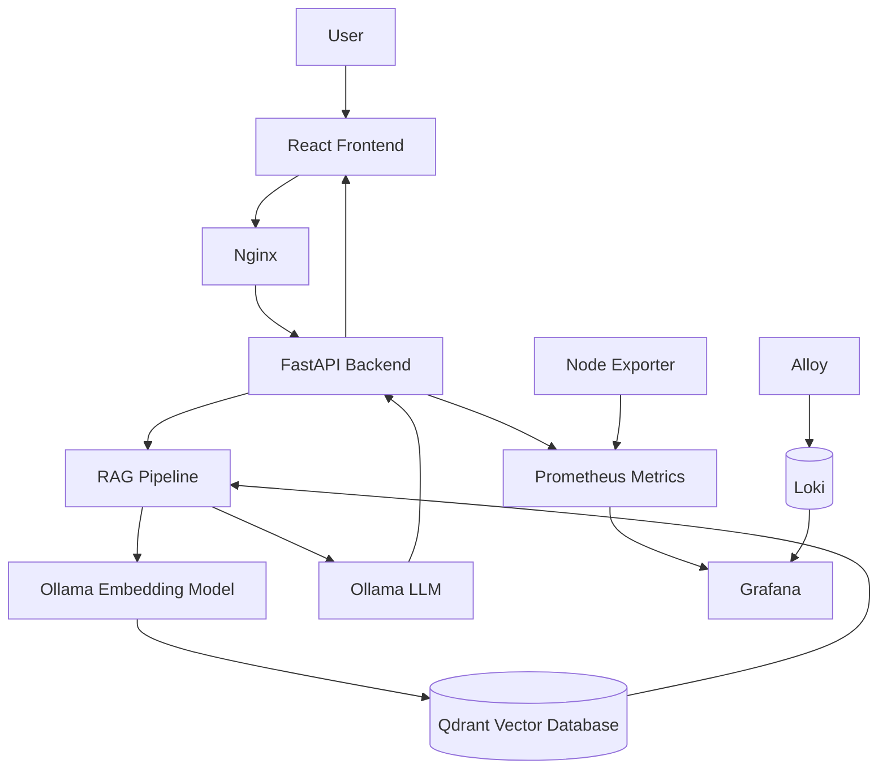

# Enterprise AI Knowledge Assistant

An AI-powered knowledge assistant that allows users to upload PDF documents and ask questions about their content. It uses Retrieval-Augmented Generation (RAG) to retrieve relevant information from documents and generate context-aware answers with source citations.

The project is built using React, FastAPI, Ollama, and Qdrant, with containerization through Docker and orchestration through Kubernetes. It also includes an observability stack using Prometheus, Grafana, Loki, Alloy, and Node Exporter.

## Key Features

- **PDF Upload:** Upload PDF documents through the web interface.
- **AI-Powered Question Answering:** Ask questions about uploaded documents using a RAG pipeline.
- **Context-Aware Responses:** Retrieve relevant document chunks before generating answers.
- **Source Citations:** Display references to the source documents used to generate answers.
- **Document Management:** Delete uploaded documents.
- **Local LLM Integration:** Use Ollama to run local language and embedding models.
- **Vector Search:** Store and retrieve document embeddings using Qdrant.
- **REST API:** Backend APIs built using FastAPI.
- **Containerization:** Package the frontend and backend using Docker.
- **Kubernetes Deployment:** Deploy and manage application components using Minikube.
- **Monitoring:** Collect application and infrastructure metrics using Prometheus and Node Exporter.
- **Centralized Logging:** Collect Kubernetes pod logs using Alloy and store them in Loki.
- **Dashboards:** Visualize metrics and logs through Grafana.

## Architecture



### Application Flow

1. The user uploads a PDF through the React frontend.
2. The frontend communicates with the FastAPI backend through Nginx.
3. The backend processes the document and generates embeddings using Ollama.
4. Document embeddings are stored in Qdrant.
5. When a user asks a question, the RAG pipeline retrieves relevant document chunks.
6. Ollama generates an answer using the retrieved context.
7. The frontend displays the answer along with source citations.

### Observability Flow

- Prometheus collects metrics from the backend and Node Exporter.
- Alloy discovers and collects Kubernetes pod logs.
- Alloy forwards logs to Loki.
- Grafana visualizes metrics and logs through dashboards.

## Technology Stack

| Layer            | Technologies                   |
| ---------------- | ------------------------------ |
| Frontend         | React 19, Vite, JavaScript     |
| Web Server       | Nginx                          |
| Backend          | Python, FastAPI                |
| AI / LLM         | Ollama, Qwen3 4B               |
| Embeddings       | Qwen3 Embedding 0.6B           |
| RAG              | Retrieval-Augmented Generation |
| Vector Database  | Qdrant                         |
| Containerization | Docker                         |
| Orchestration    | Kubernetes, Minikube           |
| Metrics          | Prometheus, Node Exporter      |
| Logging          | Grafana Alloy, Loki            |
| Visualization    | Grafana                        |
| Version Control  | Git, GitHub                    |

## Project Structure

```text
Enterprise-AI-Knowledge-Assistant/
│
├── backend/
│   ├── app/
│   │   └── routes/
│   │       └── health.py
│   └── Dockerfile
│
├── frontend/
│   ├── src/
│   │   └── services/
│   │       └── api.js
│   ├── nginx.conf
│   └── Dockerfile
│
├── deployment/
│   ├── docker-compose.yaml
│   └── kubernetes/
│       ├── namespace.yaml
│       ├── backend.yaml
│       ├── frontend.yaml
│       ├── ingress.yaml
│       ├── prometheus.yaml
│       ├── node-exporter.yaml
│       ├── loki.yaml
│       ├── alloy.yaml
│       └── grafana.yaml
│
├── monitoring/
│   ├── prometheus.yml
│   ├── prometheus-k8s.yml
│   ├── loki-config.yml
│   ├── alloy-config.alloy
│   └── alloy-k8s.alloy
│
├── .gitignore
└── README.md
```

_Note: The structure above highlights the main project and deployment files._

## Prerequisites

Install the following tools before running the project:

- Docker Desktop
- Git
- Ollama
- Kubernetes CLI (`kubectl`)
- Minikube
- A system with sufficient memory and CPU resources to run the local AI models and Kubernetes workloads.

For local AI inference, download the required Ollama models:

```bash
ollama pull qwen3:4b
ollama pull qwen3-embedding:0.6b
```

Ensure Ollama is running and accessible from the application environment.

## Running the Application

### 1. Docker Compose

From the project root directory:

```bash
docker compose -f deployment/docker-compose.yaml up -d --build
```

Check running containers:

```bash
docker ps
```

To inspect logs:

```bash
docker compose -f deployment/docker-compose.yaml logs -f
```

Use the service ports configured in the Compose file to access the application and monitoring interfaces.

### 2. Kubernetes Deployment Using Minikube

Start Minikube:

```bash
minikube start --driver=docker
```

Enable the Ingress addon:

```bash
minikube addons enable ingress
```

Apply the Kubernetes namespace:

```bash
kubectl apply -f deployment/kubernetes/namespace.yaml
```

Apply the application and monitoring resources:

```bash
kubectl apply -f deployment/kubernetes/
```

Check the deployed resources:

```bash
kubectl get pods -n enterprise-ai
kubectl get services -n enterprise-ai
kubectl get deployments -n enterprise-ai
```

Wait until the required pods reach the `Running` and `Ready` states.

### 3. Access the Application

The application is configured with the Ingress hostname:

```text
enterprise-ai.local
```

For local Windows access, configure the hosts file with:

```text
127.0.0.1 enterprise-ai.local
```

Start the Ingress port-forward:

```bash
kubectl port-forward service/ingress-nginx-controller 8081:80 -n ingress-nginx
```

Open:

```text
http://enterprise-ai.local:8081
```

Keep the port-forward terminal running while accessing the application.

### 4. Access Monitoring Tools

Start port-forwarding in separate terminals.

**Grafana**

```bash
kubectl port-forward service/grafana 3003:3000 -n enterprise-ai
```

Open: `http://localhost:3003`

**Prometheus**

```bash
kubectl port-forward service/prometheus 9091:9090 -n enterprise-ai
```

Open: `http://localhost:9091`

Grafana is configured to visualize application metrics and centralized logs using Prometheus and Loki data sources.

## Monitoring and Observability

The project includes an integrated observability stack.

| Component     | Responsibility                             |
| ------------- | ------------------------------------------ |
| Prometheus    | Collects and stores time-series metrics    |
| Node Exporter | Exposes infrastructure and system metrics  |
| Grafana Alloy | Discovers and collects Kubernetes pod logs |
| Loki          | Stores and queries centralized logs        |
| Grafana       | Provides dashboards for metrics and logs   |

The Grafana dashboard includes panels for:

- Backend memory usage
- Backend CPU usage
- Network transmit traffic
- Network receive traffic
- Backend availability
- Kubernetes pod logs

### Useful Verification Commands

Check all pods:

```bash
kubectl get pods -n enterprise-ai
```

Check services:

```bash
kubectl get svc -n enterprise-ai
```

Check backend logs:

```bash
kubectl logs deployment/backend -n enterprise-ai
```

Check backend health:

```bash
kubectl port-forward service/backend 8000:8000 -n enterprise-ai
```

Then open:

```text
http://localhost:8000/health
```

Check backend metrics:

```text
http://localhost:8000/metrics
```

## Important Configuration Notes

- Ollama must be running and the required models must be available.
- The Kubernetes backend configuration uses `host.minikube.internal` to communicate with host-running Ollama and Qdrant services.
- Qdrant must be available on port `6333`.
- Application images must be available to the Minikube cluster before starting deployments when using `imagePullPolicy: Never`.
- Persistent volumes are used for application uploads and monitoring data.
- Do not delete persistent volumes when stopping or restarting Minikube.
- Configure credentials and environment variables securely. Do not commit private keys, API keys, passwords, or uploaded documents to GitHub.

## Troubleshooting

**Pods are not starting**

```bash
kubectl get pods -n enterprise-ai
kubectl describe pod <pod-name> -n enterprise-ai
```

**Check application logs**

```bash
kubectl logs deployment/backend -n enterprise-ai
```

**Check Minikube status**

```bash
minikube status
```

**Check Kubernetes resources**

```bash
kubectl get all -n enterprise-ai
```

**Restart Minikube**

```bash
minikube stop
minikube start --driver=docker
```

After restarting Minikube, restart the required port-forward commands.

## Future Improvements

- Authentication and role-based access control.
- Improved document processing and retrieval strategies.
- More comprehensive automated testing.
- Alerting and advanced observability.
- Production-ready deployment and secrets management.
- Performance optimization and resource tuning.

## Author

Developed as an Enterprise AI Knowledge Assistant project, combining document-based question answering, local AI inference, vector search, Kubernetes deployment, and integrated observability.
