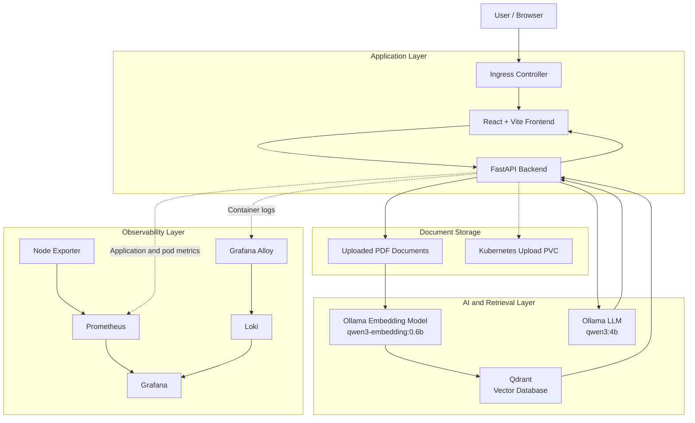
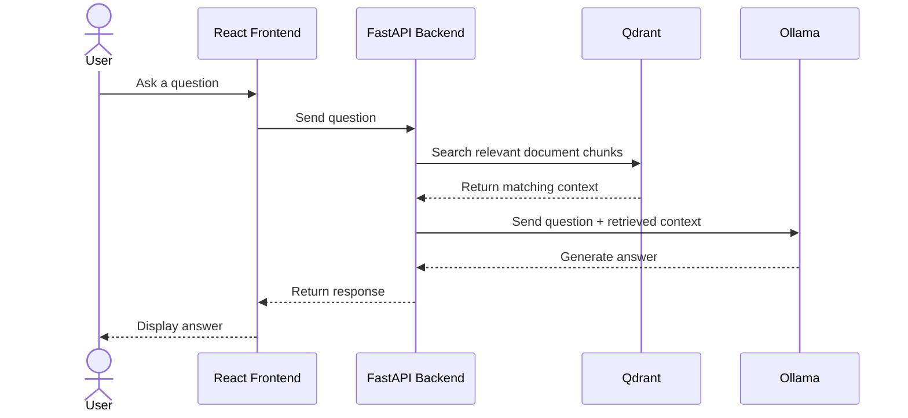
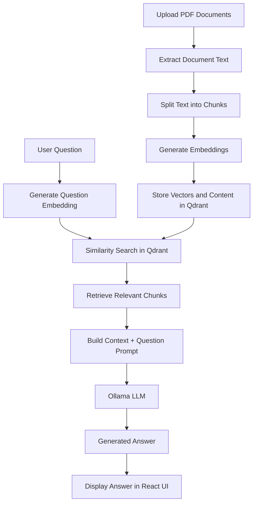
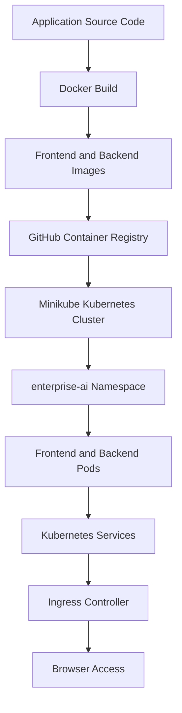
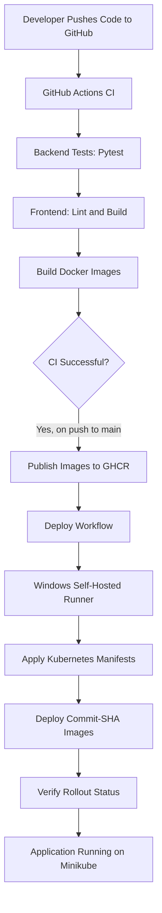
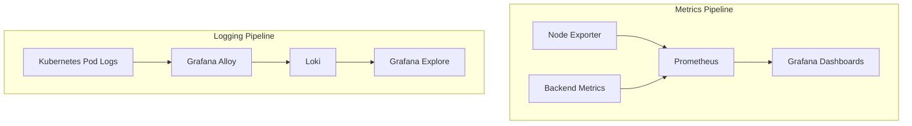

# Enterprise AI Knowledge Assistant — System Architecture

## 1. Project Overview

The **Enterprise AI Knowledge Assistant** is a PDF-based Retrieval-Augmented Generation (RAG) application. It allows users to upload PDF documents and ask natural-language questions using information retrieved from those documents.

The system combines:

- React and Vite for the frontend.
- Python and FastAPI for backend APIs.
- Ollama for local LLM inference and text embeddings.
- Qdrant for vector storage and similarity search.
- Docker for containerization.
- Kubernetes (Minikube) for deployment and orchestration.
- GitHub Actions and GHCR for CI/CD.
- Prometheus, Node Exporter, Grafana Alloy, Loki and Grafana for observability.

## 2. High-Level System Architecture

The architecture is divided into four main layers:

1. **Application layer:** React frontend and FastAPI backend.
2. **AI and retrieval layer:** Ollama models and Qdrant vector database.
3. **Deployment layer:** Docker containers, Kubernetes workloads, Services and Ingress.
4. **Observability layer:** Metrics collection, centralized logging and Grafana visualization.

### Architecture Diagram

**Note:** The application workloads and observability components are deployed in the `enterprise-ai` Kubernetes namespace. Ollama and Qdrant are reached through their configured local endpoints using `host.minikube.internal`.

## 3. Application Request Flow

When a user interacts with the assistant:

1. The browser accesses the application through the Kubernetes Ingress endpoint.
2. The React frontend provides the document upload and question-answering interface.
3. The frontend communicates with the FastAPI backend.
4. The backend processes document uploads and user questions.
5. For a question, the backend retrieves relevant document context through the vector database.
6. The retrieved context is passed to the Ollama language model.
7. The generated response is returned through FastAPI to the frontend.

## 4. Retrieval-Augmented Generation (RAG) Pipeline

RAG improves question answering by retrieving relevant information from uploaded documents before generating a response.

### Document Ingestion

1. User uploads one or more PDF documents.
2. FastAPI processes the uploaded documents and extracts their text.
3. Extracted text is divided into smaller chunks.
4. The Ollama embedding model converts chunks into vector representations.
5. Vectors and their associated document content are stored in Qdrant.

### Question Answering

1. User submits a natural-language question.
2. The question is converted into an embedding.
3. Qdrant performs similarity search to find relevant document chunks.
4. Retrieved context is combined with the original question.
5. The Ollama LLM generates a context-informed answer.
6. The answer is returned to the frontend.

### RAG Flowchart

The application was tested with multiple PDF documents in a shared knowledge base.

## 5. Containerization and Kubernetes Deployment

Docker is used to package the frontend and backend into separate container images.

The images are published to GitHub Container Registry (GHCR) and deployed to a local Kubernetes cluster using Minikube.

### Kubernetes Components

| Component           | Responsibility                                        |
| ------------------- | ----------------------------------------------------- |
| Namespace           | Isolates project workloads in `enterprise-ai`         |
| Frontend Deployment | Runs the React frontend                               |
| Frontend Service    | Exposes the frontend inside the cluster               |
| Backend Deployment  | Runs the FastAPI application                          |
| Backend Service     | Exposes backend APIs inside the cluster               |
| Upload PVC          | Provides persistent-volume storage for uploaded files |
| Ingress             | Provides browser access to the application            |
| Prometheus          | Collects and stores metrics                           |
| Node Exporter       | Exposes node-level metrics                            |
| Alloy               | Collects Kubernetes pod logs                          |
| Loki                | Stores and serves log queries                         |
| Grafana             | Visualizes metrics and logs                           |

### Deployment Flow

**Application URL:** `http://enterprise-ai.local:8081`

The URL is accessed through the local Ingress controller using port forwarding.

## 6. CI/CD Architecture

GitHub Actions automates testing, building and publishing container images.

A successful CI workflow triggers the deployment workflow, which uses a Windows self-hosted GitHub Actions runner to deploy the application to the local Minikube cluster.

### Continuous Integration

- Triggered by pushes to `main` and pull requests targeting `main`.
- Installs backend development dependencies and runs Pytest.
- Installs frontend dependencies using `npm ci`.
- Runs frontend linting and production build.
- Builds backend and frontend Docker images.
- Publishes images to GHCR on successful pushes to `main`.
- Publishes `latest` and commit-SHA image tags.

### Continuous Deployment

- Triggered after successful completion of the CI workflow on `main`.
- Uses the self-hosted Windows runner.
- Checks out the successful commit.
- Deploys images tagged with the corresponding commit SHA.
- Applies Kubernetes manifests.
- Verifies deployment rollout status.

### CI/CD Flowchart

## 7. Integrated Observability Architecture

The project uses separate metrics and logging pipelines, with Grafana providing a common visualization interface.

### Metrics Pipeline

- Node Exporter exposes node-level metrics.
- Prometheus scrapes configured targets, including itself, the backend and Node Exporter.
- Prometheus stores time-series metrics.
- Grafana queries Prometheus to display dashboards and graphs.

### Logging Pipeline

- Application and Kubernetes pod logs are collected by Grafana Alloy.
- Alloy forwards collected logs to Loki.
- Loki stores and indexes log streams for querying.
- Grafana Explore allows users to search and inspect logs.

### Observability Flowchart

### Verified Observability Checks

- Prometheus returned three active targets with `up = 1`.
- Node Exporter metrics were available.
- Alloy successfully collected and forwarded Kubernetes pod logs.
- Loki labels and log queries returned actual data.
- Grafana Prometheus and Loki data sources passed their connection tests.
- Grafana dashboards and Explore displayed metrics and logs.

## 8. Local Deployment Environment

The project currently runs in a local development and demonstration environment.

| Layer              | Environment                |
| ------------------ | -------------------------- |
| Operating System   | Windows                    |
| Container Runtime  | Docker Desktop             |
| Kubernetes         | Minikube                   |
| Kubernetes Context | `minikube`                 |
| Project Namespace  | `enterprise-ai`            |
| Container Registry | GitHub Container Registry  |
| CI/CD              | GitHub Actions             |
| Deployment Runner  | Windows self-hosted runner |

## 9. Current Scope and Future Improvements

The core application, RAG workflow, Kubernetes deployment, CI/CD pipeline and observability integration have been implemented and verified.

The following are potential improvements:

- Dedicated verification of uploaded-file persistence after a backend pod restart.
- Investigation of Loki structured-metadata parsing warnings.
- Migration from deprecated Kubernetes Endpoints discovery where applicable.
- Security review of the public repository and self-hosted runner.
- Resource requests and limits, backups, stronger access controls and production-grade deployment.
- Migration from local Minikube to a managed Kubernetes environment.

**Deployment limitation:** The current deployment targets local Minikube and is not a production cloud deployment.

## 10. Conclusion

The Enterprise AI Knowledge Assistant demonstrates an end-to-end engineering workflow:

**PDF ingestion → RAG-based retrieval → LLM answer generation → Docker containerization → Kubernetes deployment → automated CI/CD → metrics and centralized logging.**

The project integrates AI application development with container orchestration, deployment automation and operational observability.
